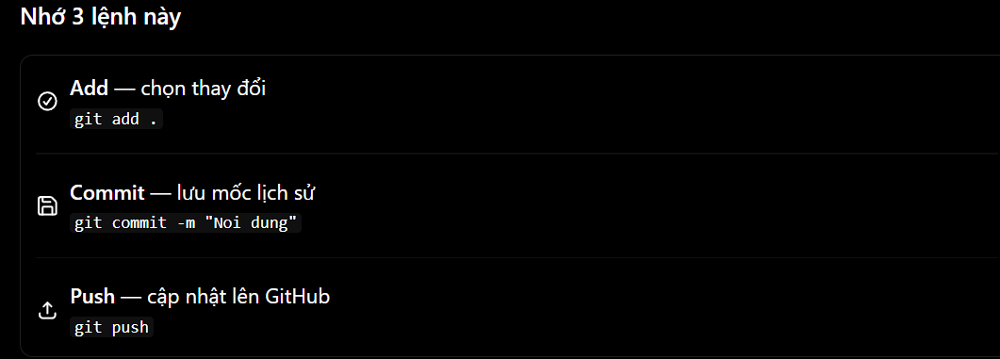
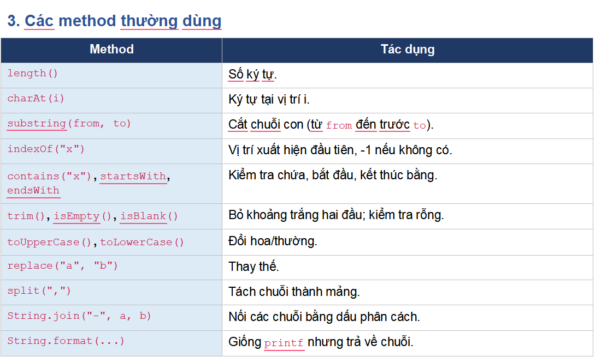
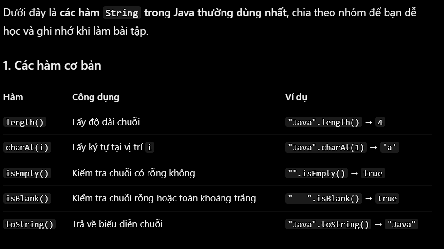
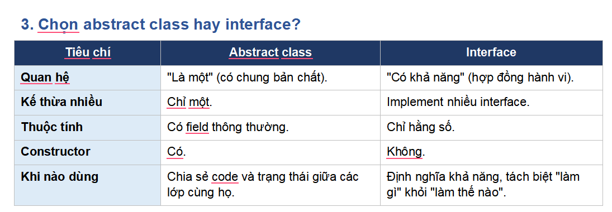

buổi 7 oop
Một số điều cần nhớ
•Mỗi class chỉ kế thừa một class cha (đơn kế thừa). Mọi class đều ngầm kế thừa Object, nên ai cũng có toString(), equals(), hashCode().
•Nếu không gọi super(...), Java tự gọi constructor mặc định của cha. Nếu cha không có constructor mặc định thì bắt buộc phải gọi super(...) thủ công.
•Chỉ nên kế thừa khi thực sự có quan hệ "là một". Nếu chỉ muốn dùng lại code, hãy cân nhắc composition (class này chứa object của class kia).
•Từ khóa final trước class hay method ngăn việc kế thừa hoặc ghi đè.
class là bản thiết kế dùng để tạo ra các đối tượng.
object — Đối tượng:
Đối tượng là một thực thể được tạo ra từ lớp.
public là từ khóa quy định quyền truy cập. Thành phần được khai báo public có thể được truy cập từ những nơi khác, miễn là đối tượng và lớp chứa nó cũng truy cập được.
private — Chỉ truy cập trực tiếp bên trong lớp
private giới hạn quyền truy cập trực tiếp vào thuộc tính hoặc phương thức, chỉ trong lớp khai báo nó.
Ghi nhớ: private giúp bảo vệ dữ liệu, là nền tảng của tính đóng gói trong OOP.
Constructor — Hàm khởi tạo
Constructor là phần đặc biệt được gọi khi tạo đối tượng bằng new.
Getter — Phương thức lấy dữ liệu
Getter là phương thức dùng để đọc giá trị của thuộc tính, thường được dùng khi thuộc tính là private.
Setter — Phương thức thay đổi dữ liệu
Setter dùng để cập nhật giá trị thuộc tính.
@Override dùng để báo cho Java biết rằng: “Tôi đang viết lại một phương thức đã có ở lớp cha hoặc triển khai một phương thức từ Interface.”
--Abstract class là lớp trừu tượng, dùng làm khuôn mẫu chung cho các lớp con.
Hãy tưởng tượng bạn đang xây dựng chương trình quản lý động vật. Tất cả động vật đều có tên, nhưng mỗi loài phát ra âm thanh khác nhau.

- Chó sủa.
- Mèo kêu meo meo.
- Vịt kêu cạp cạp.
  interface (giao diện) là một bản quy định những phương thức mà một lớp (class) cần cung cấp khi triển khai giao diện đó.
  default Phương thức mặc định: có thân hàm, lớp triển khai không bắt buộc phải ghi đè.
  static Phương thức tĩnh: gọi thông qua tên interface, ví dụ Animal.info().
  private Phương thức riêng tư: chỉ được sử dụng bên trong interface để hỗ trợ các phương thức khác của interface.
  --Mình giải thích từ gốc nhé. Trong Java, phương thức tĩnh (static method) là phương thức thuộc về lớp (class) chứ không thuộc riêng một đối tượng nào của lớp đó.
  Interface là một hợp đồng: liệt kê những việc mà class phải làm được, không quan tâm làm thế nào. Class dùng implements để cam kết thực hiện hợp đồng đó, và một class có thể implement nhiều interface.
  
